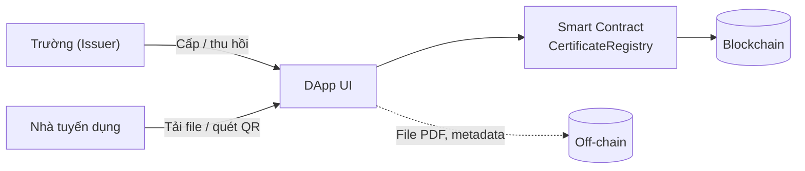

# Certificate DApp: Xác minh chứng chỉ số trên Blockchain

Báo cáo môn học Blockchain. DApp cho phép **trường cấp và thu hồi chứng chỉ**, **sinh viên nhận chứng chỉ kèm mã QR**, **nhà tuyển dụng tự xác minh** bằng cách tải file lên, không cần ví và không tốn phí.

> Toàn bộ dữ liệu mẫu (tên người, mã số, đơn vị cấp) là **hư cấu**, chỉ dùng để học tập.

## Ý tưởng

- **On-chain** chỉ lưu mã băm `keccak256` của file chứng chỉ, địa chỉ đơn vị cấp, địa chỉ người nhận, thời điểm và trạng thái. File PDF và dữ liệu cá nhân nằm **off-chain**.
- Chỉ ví được owner cấp quyền (issuer) mới cấp/thu hồi được; chỉ đúng đơn vị đã cấp mới thu hồi được chứng chỉ của mình.
- Xác minh: tính hash file ngay trên trình duyệt, đối chiếu với bản ghi trên chuỗi. Chỉ cần sửa một chi tiết nhỏ trong file, hash đổi hoàn toàn nên bị phát hiện.



## Cấu trúc

```
├── contracts/CertificateRegistry.sol   Smart Contract
├── test/CertificateRegistry.test.js    20 test (Mocha + Chai)
├── scripts/
│   ├── deploy.js                       triển khai, ghi frontend/contract.json
│   ├── seed.js                         nạp dữ liệu mẫu lên chuỗi
│   ├── gas-report.js                   đo gas -> docs/gas-report.md
│   ├── hash-file.js                    tính hash keccak256 của file
│   └── generate_sample_pdfs.py         sinh PDF + metadata mẫu (tùy chọn)
├── data/
│   ├── certificates.json               cấu hình dữ liệu mẫu
│   ├── hashes.json                     hash của các PDF mẫu
│   ├── seeded.json                     ví dụ kết quả nạp lên chuỗi
│   ├── sample-pdfs/                    6 PDF mẫu + 1 bản bị sửa
│   └── metadata/                       metadata off-chain
├── frontend/                           giao diện (HTML/CSS/JS + ethers, QR)
└── docs/BAO_CAO.md                     báo cáo đầy đủ
```

## Chạy nhanh

Yêu cầu: **Node.js 18+**.

```bash
npm install
npm test                 # 20 test của Smart Contract
```

Chạy ứng dụng (3 terminal):

```bash
npm run node             # Terminal 1: mạng Blockchain cục bộ
npm run setup            # Terminal 2: deploy + nạp dữ liệu mẫu
npm run serve            # Terminal 3: mở http://localhost:3000/frontend/
```

> Mỗi lần khởi động lại `npm run node`, chuỗi bị xóa sạch. Hãy chạy lại `npm run setup`.

### Thử ngay không cần ví

Mở `http://localhost:3000/frontend/` → tab **Xác minh** → tải `data/sample-pdfs/CERT-001.pdf` (Hợp lệ), `CERT-001_tampered.pdf` (Không tìm thấy), hoặc bấm các nút ở phần "Dữ liệu mẫu" (CERT-006 là chứng chỉ đã thu hồi).

### Dùng với MetaMask (cấp, thu hồi, xem chứng chỉ)

1. Thêm mạng: RPC `http://127.0.0.1:8545`, chainId `31337`, ký hiệu ETH (giao diện cũng tự đề nghị thêm/chuyển mạng).
2. Nhập khóa riêng của các tài khoản Hardhat do `npm run node` in ra. **Đây là khóa công khai, chỉ dùng cho mạng cục bộ.**
3. Chọn tài khoản theo vai trò:

| Tài khoản | Vai trò |
|---|---|
| #0 | Owner, quản trị đơn vị cấp |
| #1 | Đơn vị cấp: Trường Đại học Công nghệ Mẫu |
| #2 | Đơn vị cấp: Trung tâm Ngoại ngữ Mẫu |
| #3 | Sinh viên Nguyễn Văn An (CERT-001, CERT-005) |
| #4 đến #7 | Các sinh viên còn lại trong dữ liệu mẫu |
| #8 trở đi | Ví trống, dùng làm người nhận khi thử cấp chứng chỉ mới |

Giao diện tự hiện các tab phù hợp với vai trò của ví đang kết nối.

## Các lệnh

| Lệnh | Tác dụng |
|---|---|
| `npm test` | Chạy bộ test Smart Contract |
| `npm run node` | Khởi động mạng Hardhat cục bộ |
| `npm run deploy` | Triển khai contract, ghi `frontend/contract.json` |
| `npm run seed` | Cấp quyền issuer, cấp và thu hồi chứng chỉ mẫu |
| `npm run setup` | `deploy` rồi `seed` |
| `npm run serve` | Chạy web server tĩnh (cổng 3000) |
| `npm run gas` | Đo gas, ghi `docs/gas-report.md` |
| `npm run hash -- <file>` | In hash keccak256 của file |
| `npm run hash -- --all` | Tính lại `data/hashes.json` |

## Smart Contract

| Hàm | Ai gọi | Mô tả |
|---|---|---|
| `setIssuer(address, bool)` | Owner | Thêm/gỡ quyền cấp chứng chỉ |
| `issueCertificate(bytes32, address, string)` | Issuer | Cấp chứng chỉ (từ chối nếu hash đã tồn tại) |
| `revokeCertificate(bytes32)` | Issuer đã cấp | Đổi trạng thái sang `Revoked` (không xóa bản ghi) |
| `verifyCertificate(bytes32)` | Bất kỳ ai | Trả về trạng thái, issuer, holder, thời điểm, metadataURI (hàm `view`, miễn phí) |

Sự kiện: `IssuerUpdated`, `CertificateIssued`, `CertificateRevoked`, dùng để truy vết lịch sử.

## Tự tạo lại dữ liệu mẫu (tùy chọn)

```bash
pip install reportlab
python3 scripts/generate_sample_pdfs.py   # sinh lại PDF + metadata
npm run hash -- --all                     # tính lại hash
npm run setup                             # nạp lên chuỗi
```

Nếu font mặc định không có trên máy, sửa `FONT_CANDIDATES` trong script (cần font hỗ trợ tiếng Việt).

## Lưu ý và hạn chế

- Chưa triển khai và kiểm thử trên testnet công khai. `hardhat.config.js` có cấu hình Sepolia tùy chọn (qua biến môi trường) nhưng chưa được chạy thử. Nếu dùng, **đừng commit** `frontend/contract.json` khi `rpcUrl` chứa API key.
- Chưa kiểm toán bảo mật Smart Contract.
- Mã QR chỉ quét được từ điện thoại khi trang web được đưa lên địa chỉ truy cập được từ Internet, không phải `localhost`.
- Metadata off-chain không được bảo vệ toàn vẹn bởi chuỗi; căn cứ tin cậy là hash của file PDF.

## Báo cáo

Xem [`docs/BAO_CAO.md`](docs/BAO_CAO.md) (có sơ đồ Mermaid, bảng test, số liệu gas và ảnh demo).

## Tác giả

`[Họ và tên]` · `[MSSV]` · `[Lớp]`

## Giấy phép

MIT. Thư viện đóng gói sẵn trong `frontend/lib`: ethers (MIT), qrcode-generator (MIT).
