# BÁO CÁO MÔN HỌC: BLOCKCHAIN

## ĐỀ TÀI: XÂY DỰNG DAPP QUẢN LÝ VÀ XÁC MINH CHỨNG CHỈ SỐ TRÊN BLOCKCHAIN

---

## MỤC LỤC

1. [Chương 1. Mở đầu](#chương-1-mở-đầu)
2. [Chương 2. Cơ sở lý thuyết](#chương-2-cơ-sở-lý-thuyết)
3. [Chương 3. Phân tích bài toán](#chương-3-phân-tích-bài-toán)
4. [Chương 4. Thiết kế hệ thống](#chương-4-thiết-kế-hệ-thống)
5. [Chương 5. Triển khai và kết quả](#chương-5-triển-khai-và-kết-quả)
6. [Chương 6. Đánh giá và hướng phát triển](#chương-6-đánh-giá-và-hướng-phát-triển)
7. [Chương 7. Kết luận](#chương-7-kết-luận)
8. [Tài liệu tham khảo](#tài-liệu-tham-khảo)
9. [Phụ lục](#phụ-lục)

---

## Chương 1. Mở đầu

### 1.1. Đặt vấn đề

Bằng cấp và chứng chỉ là cơ sở để đánh giá năng lực của một cá nhân khi xin việc, học tiếp hoặc xét tuyển. Tuy nhiên, quy trình xác minh hiện nay còn nhiều bất cập:

- **Bằng giả, chứng chỉ giả:** việc làm giả tài liệu giấy hoặc file PDF tương đối dễ, trong khi người kiểm tra khó phân biệt thật giả.
- **Khó xác minh văn bằng:** nhà tuyển dụng thường phải liên hệ trực tiếp với trường, mất thời gian và phụ thuộc vào quy trình thủ công của từng đơn vị.
- **Hồ sơ học tập phân tán:** thành tích học tập nằm rải rác ở nhiều nơi, khó chia sẻ và kiểm chứng.

Những vấn đề trên bắt nguồn từ việc niềm tin đang đặt hoàn toàn vào một bên trung gian (cơ sở dữ liệu của từng tổ chức). Đây cũng chính là loại bài toán mà Blockchain hướng đến: **nhiều bên cùng tham gia, các bên không hoàn toàn tin nhau, cần chia sẻ dữ liệu, cần kiểm chứng lịch sử và dữ liệu khó bị thay đổi.**

### 1.2. Mục tiêu đề tài

**Mục tiêu tổng quát:** Thiết kế và xây dựng một ứng dụng phi tập trung (DApp) cho phép cấp, thu hồi và xác minh chứng chỉ số dựa trên Blockchain.

**Mục tiêu cụ thể:**

1. Hệ thống hóa kiến thức nền tảng về Blockchain, Smart Contract và DApp.
2. Phân tích bài toán và xác định khi nào Blockchain thực sự phù hợp.
3. Thiết kế kiến trúc DApp gồm giao diện, Smart Contract và Blockchain, có kết hợp lưu trữ off-chain.
4. Xây dựng Smart Contract với các chức năng: cấp chứng chỉ, thu hồi chứng chỉ, xác minh chứng chỉ.
5. Đánh giá ưu điểm, hạn chế và so sánh với ứng dụng truyền thống.

### 1.3. Đối tượng và phạm vi

- **Đối tượng nghiên cứu:** Công nghệ Blockchain, Smart Contract và mô hình DApp áp dụng cho bài toán chứng chỉ số.
- **Phạm vi:** Xây dựng bản mẫu (prototype) chạy trên mạng thử nghiệm (testnet) hoặc mạng cục bộ. Không triển khai trên mạng chính thức và không xử lý các vấn đề pháp lý, hành chính ngoài phạm vi môn học.

### 1.4. Phương pháp thực hiện

- Nghiên cứu tài liệu và nội dung môn học.
- Phân tích nghiệp vụ, xác định các bên tham gia và quy tắc nghiệp vụ.
- Thiết kế kiến trúc và Smart Contract.
- Cài đặt thử nghiệm và kiểm thử.
- Đánh giá, so sánh với mô hình ứng dụng truyền thống.

### 1.5. Bố cục báo cáo

Báo cáo gồm 7 chương: mở đầu, cơ sở lý thuyết, phân tích bài toán, thiết kế hệ thống, triển khai và kết quả, đánh giá và hướng phát triển, kết luận.

---

## Chương 2. Cơ sở lý thuyết

### 2.1. Tổng quan về Blockchain

#### 2.1.1. Khái niệm

Blockchain là một **cơ sở dữ liệu phân tán** lưu trữ dữ liệu dưới dạng các khối liên kết với nhau. Dữ liệu được chia sẻ cho mọi nút (node) trong mạng ngang hàng (P2P) thay vì tập trung tại một nơi. Mọi thành viên đều có quyền kiểm chứng nhưng không ai có thể tự ý thay đổi. Về bản chất, Blockchain là một **"cuốn sổ cái điện tử"** ghi chép giao dịch một cách an toàn và lâu dài.

#### 2.1.2. Cấu trúc của một khối

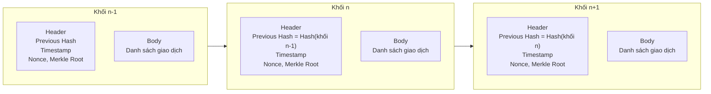

- **Block Header:** mã băm của khối trước (Previous Hash), thời gian (Timestamp), số ngẫu nhiên (Nonce) và Merkle Root.
- **Block Body:** danh sách các giao dịch đã được xác thực.
- **Hash:** "vân tay kỹ thuật số" duy nhất của khối. Vì mỗi khối chứa hash của khối trước, chỉ cần sửa dữ liệu một khối thì hash thay đổi và làm phá vỡ liên kết của cả chuỗi phía sau. Đây là cơ sở của tính **bất biến**.

#### 2.1.3. So sánh Blockchain và cơ sở dữ liệu truyền thống

| Tiêu chí | CSDL truyền thống | Blockchain |
|---|---|---|
| Quyền kiểm soát | Một tổ chức quản trị | Phi tập trung (cộng đồng) |
| Khả năng chỉnh sửa | Có thể sửa/xóa dữ liệu | Bất biến (chỉ thêm mới) |
| Tính minh bạch | Thấp (hộp đen) | Cao (công khai kiểm chứng) |
| Độ an toàn | Dễ bị tấn công tập trung | Khó tấn công (dùng mật mã) |
| Chi phí trung gian | Cao | Thấp (loại bỏ trung gian) |

#### 2.1.4. Bối cảnh ra đời và các thế hệ Blockchain

Cuộc khủng hoảng tài chính toàn cầu năm 2008 làm suy giảm niềm tin vào hệ thống ngân hàng tập trung. Tháng 10/2008, Satoshi Nakamoto công bố whitepaper *"Bitcoin: A Peer-to-Peer Electronic Cash System"*, sử dụng cơ chế đồng thuận Proof of Work để giải quyết bài toán niềm tin và **chi tiêu kép (double-spending)**.

| Đặc điểm | Blockchain 1.0 | Blockchain 2.0 | Blockchain 3.0 | Blockchain 4.0 |
|---|---|---|---|---|
| Giai đoạn | 2008 – 2013 | 2014 – 2017 | 2018 – nay | Tương lai |
| Trọng tâm | Tiền mã hóa | Smart Contract | Khả năng mở rộng | Ứng dụng doanh nghiệp/chính phủ |
| Đại diện | Bitcoin | Ethereum | Solana, Polkadot | Tích hợp AI/IoT |
| Đồng thuận | PoW | PoW/PoS | PoS/DPoS | Đa dạng/tối ưu |
| Phạm vi | Thanh toán P2P | DApp, DeFi | Đa lĩnh vực | Kinh tế số toàn cầu |

Đề tài này thuộc kỷ nguyên **Blockchain 2.0**, nơi Smart Contract cho phép Blockchain trở thành nền tảng lập trình phân tán chứ không chỉ là "ví tiền".

### 2.2. Các thành phần cơ bản

| Thành phần | Nội dung chính | Vai trò trong đề tài |
|---|---|---|
| **Sổ cái phân tán** | Mọi nút giữ một bản sao đầy đủ, nhất quán và không thể xóa/sửa sau khi ghi nhận | Lưu lịch sử cấp/thu hồi chứng chỉ |
| **Mạng ngang hàng (P2P)** | Các nút kết nối trực tiếp, không có điểm lỗi duy nhất; giao dịch lan truyền qua Gossip Protocol | Dịch vụ xác minh luôn hoạt động, không phụ thuộc server của trường |
| **Cơ chế đồng thuận** | PoW, PoS, DPoS, PoA | Đảm bảo các nút thống nhất trạng thái hợp lệ |
| **Mật mã học** | Hàm băm, cặp khóa công khai/bí mật, chữ ký số | Tạo vân tay cho chứng chỉ, xác thực người ký giao dịch |
| **Máy ảo (VM)** | Môi trường thực thi chương trình trên Blockchain, ví dụ EVM | Chạy Smart Contract |

**Các cơ chế đồng thuận phổ biến:**

| Cơ chế | Ý tưởng | Đặc điểm | Ví dụ |
|---|---|---|---|
| PoW | Giải bài toán toán học phức tạp | Bảo mật cao nhưng tốn năng lượng | Bitcoin |
| PoS | Xác minh dựa trên lượng tài sản đặt cọc | Tiết kiệm năng lượng, nhanh hơn | Ethereum hiện nay |
| DPoS | Ủy quyền cho các đại diện xác thực | Hiệu suất cao | EOS, TRON |
| PoA | Dựa trên danh tính, uy tín của nút xác thực | Phù hợp mạng nội bộ doanh nghiệp | Mạng riêng/liên doanh |

### 2.3. Các thành phần mở rộng

- **Hợp đồng thông minh (Smart Contract):** đoạn mã tự động thực hiện thỏa thuận khi điều kiện được đáp ứng; mã nguồn công khai và không thể sửa đổi sau khi triển khai.
- **Tài sản số (Coin và Token):** Coin là đồng tiền gốc của một blockchain (Layer 1) như BTC, ETH; Token được phát hành trên nền tảng có sẵn thông qua Smart Contract, ví dụ USDT hoặc NFT (ERC-721).
- **Ví điện tử (Wallet):** quản lý cặp khóa công khai (như số tài khoản) và khóa bí mật (dùng ký giao dịch, tuyệt mật). Ví nóng kết nối Internet (tiện dụng nhưng rủi ro hơn), ví lạnh lưu ngoại tuyến (an toàn hơn).
- **Các lớp Blockchain:** Layer 1 là chuỗi nền tảng (Bitcoin, Ethereum), Layer 2 là giải pháp mở rộng giảm phí (Lightning Network, Polygon, Arbitrum), Layer 3 là lớp ứng dụng (DApp, NFT Marketplace).
- **DApp và Oracle:** DApp là ứng dụng chạy trên Blockchain, không phụ thuộc máy chủ trung tâm; Oracle là cầu nối đưa dữ liệu thực tế (giá, thời tiết, ...) vào Smart Contract.
- **DAO:** tổ chức tự trị phi tập trung, hoạt động dựa trên mã nguồn và biểu quyết bằng token.

### 2.4. Phân loại Blockchain

| Đặc điểm | Public | Private | Consortium | Hybrid |
|---|---|---|---|---|
| Quyền tham gia | Mọi người | Một tổ chức | Nhiều tổ chức | Kết hợp |
| Tốc độ | Thấp | Rất cao | Trung bình – cao | Tùy thiết kế |
| Phi tập trung | Tuyệt đối | Thấp | Trung bình | Linh hoạt |
| Ứng dụng tiêu biểu | DeFi, NFT | Nội bộ doanh nghiệp | Ngân hàng, logistics | Dữ liệu nhạy cảm riêng tư, dữ liệu kiểm chứng công khai |
| Ví dụ | Bitcoin, Ethereum | Hyperledger Fabric | R3 Corda | IBM Food Trust |

### 2.5. Đặc điểm nổi bật

Bảy đặc điểm tạo nên sự khác biệt của Blockchain: **phi tập trung, bất biến, minh bạch, bảo mật, cơ chế đồng thuận, khả năng truy vết và kiểm toán, Smart Contract.** Các đặc điểm này liên quan chặt chẽ với nhau để tạo nên một hệ thống đáng tin cậy. Ví dụ, tính bất biến dựa vào hàm băm và liên kết giữa các khối; tính bảo mật dựa vào chữ ký số và khóa công khai/bí mật.

### 2.6. Lợi ích và thách thức

**Lợi ích:** minh bạch và tin cậy; an toàn và bảo mật; giảm phụ thuộc trung gian; tăng tốc độ xử lý; truy xuất nguồn gốc; tự động hóa bằng Smart Contract; mở rộng tiếp cận tài chính; ứng dụng trong nhiều lĩnh vực.

**Thách thức (7 nhóm):** khả năng mở rộng (Blockchain Trilemma), tiêu thụ năng lượng, tính phức tạp/khó sử dụng, pháp lý và quản lý, nguy cơ bảo mật, khả năng tương tác và chuẩn hóa, nguy cơ bị dùng cho hoạt động phi pháp.

Thông điệp xuyên suốt của môn học: không hỏi *"Blockchain có tốt không?"* mà hỏi ***"Blockchain có phù hợp với bài toán này không?"***

### 2.7. Từ ứng dụng truyền thống đến DApp

**DApp = Giao diện người dùng + Smart Contract + Blockchain.** Một số dữ liệu và nghiệp vụ quan trọng được đưa lên Blockchain thay vì do Backend kiểm soát.

| Nội dung | Ứng dụng truyền thống | DApp |
|---|---|---|
| Backend | Server | Smart Contract / Blockchain |
| Database | Database tập trung | Blockchain + off-chain |
| Kiểm soát | Tổ chức | Quy tắc trên hệ thống |
| Giao dịch | Server xử lý | Blockchain xác nhận |
| Dữ liệu | Có thể sửa | On-chain khó thay đổi |
| Tài sản số | Hạn chế | Quản lý trực tiếp |
| Chi phí giao dịch | Server/Network | Có thể phát sinh phí Blockchain |

**On-chain và Off-chain:** dữ liệu lớn không nên đưa toàn bộ lên Blockchain. Chỉ lưu những gì cần tin cậy (hash, trạng thái, quyền sở hữu) on-chain, phần còn lại lưu off-chain.

---

## Chương 3. Phân tích bài toán

### 3.1. Blockchain có phù hợp với bài toán này không?

Áp dụng bộ câu hỏi đã học để đánh giá:

| Tiêu chí của bài toán cần niềm tin | Áp dụng cho chứng chỉ số |
|---|---|
| Nhiều bên cùng tham gia | Trường, sinh viên, nhà tuyển dụng |
| Các bên không hoàn toàn tin nhau | Nhà tuyển dụng không thể mặc định tin file PDF do ứng viên cung cấp |
| Cần chia sẻ dữ liệu | Kết quả xác minh cần được nhiều bên tra cứu |
| Cần kiểm chứng lịch sử | Cần biết chứng chỉ được cấp khi nào, bởi ai, còn hiệu lực không |
| Dữ liệu khó bị thay đổi | Bản ghi cấp chứng chỉ không được âm thầm sửa |
| Tự động thực hiện quy tắc | Quy tắc "chỉ đơn vị được ủy quyền mới được cấp/thu hồi" thực thi bằng Smart Contract |

**Kết luận:** bài toán thỏa các tiêu chí nên Blockchain là lựa chọn phù hợp, đóng vai trò là **lớp xác minh** giữa trường, sinh viên và nhà tuyển dụng.

### 3.2. Quy trình chuyển bài toán thành DApp

| Bước | Nội dung | Áp dụng |
|---|---|---|
| 1 | Xác định vấn đề | Chứng chỉ giả, khó xác minh |
| 2 | Có cần Blockchain không? | Có (xem 3.1) |
| 3 | Xác định tài sản/dữ liệu | Chứng chỉ, mã băm chứng chỉ, trạng thái |
| 4 | Xác định các bên tham gia | Trường, sinh viên, nhà tuyển dụng |
| 5 | Xác định quy tắc nghiệp vụ | Ai được cấp, ai được thu hồi, ai được xác minh |
| 6 | Đưa nghiệp vụ phù hợp vào Smart Contract | Cấp, thu hồi, xác minh |
| 7 | Xây dựng giao diện DApp | Giao diện cho trường, sinh viên, nhà tuyển dụng |

### 3.3. Các bên tham gia

| Vai trò | Mô tả | Chức năng chính |
|---|---|---|
| **Trường (Issuer)** | Đơn vị cấp chứng chỉ, được cấp quyền trong hệ thống | Cấp chứng chỉ, thu hồi chứng chỉ |
| **Sinh viên (Holder)** | Người được cấp chứng chỉ | Xem chứng chỉ, nhận mã QR để chia sẻ |
| **Nhà tuyển dụng (Verifier)** | Bên cần kiểm tra tính hợp lệ | Xác minh chứng chỉ bằng mã QR hoặc file |
| **Quản trị (Owner)** | Người triển khai hợp đồng | Cấp/gỡ quyền cho các đơn vị cấp |

### 3.4. Yêu cầu hệ thống

**Yêu cầu chức năng:**

- FR1. Quản trị viên thêm/gỡ quyền cho đơn vị cấp chứng chỉ.
- FR2. Đơn vị cấp chứng chỉ tải file chứng chỉ, hệ thống tính mã băm và ghi lên Blockchain.
- FR3. Đơn vị cấp có thể thu hồi chứng chỉ do mình đã cấp.
- FR4. Bất kỳ ai cũng có thể xác minh chứng chỉ (không cần ví, không tốn phí).
- FR5. Sinh viên xem chứng chỉ của mình và nhận mã QR.

**Yêu cầu phi chức năng:**

- NFR1. **Bất biến:** bản ghi đã cấp không bị sửa/xóa âm thầm.
- NFR2. **Phân quyền:** chỉ địa chỉ ví được ủy quyền mới được cấp/thu hồi.
- NFR3. **Quyền riêng tư:** không lưu thông tin cá nhân nhạy cảm và file gốc trên chuỗi.
- NFR4. **Chi phí hợp lý:** giảm dữ liệu ghi on-chain để giảm phí giao dịch.
- NFR5. **Dễ sử dụng:** người dùng không cần hiểu toàn bộ Blockchain để dùng ứng dụng.

### 3.5. Lựa chọn loại Blockchain

| Phương án | Ưu điểm | Nhược điểm | Nhận xét |
|---|---|---|---|
| Public (testnet Ethereum) | Minh bạch, dễ triển khai và demo, công cụ phong phú | Phí giao dịch, dữ liệu công khai | **Chọn cho bản mẫu** |
| Consortium | Phù hợp nhiều trường/đơn vị cùng quản trị, hiệu suất tốt | Quản trị phức tạp, cần thỏa thuận nhiều bên | Hướng triển khai thực tế |
| Private | Nhanh, dễ phân quyền | Kém phi tập trung, phụ thuộc một tổ chức | Không phù hợp vì mất giá trị "bên thứ ba đáng tin" |

---

## Chương 4. Thiết kế hệ thống

### 4.1. Kiến trúc tổng quát

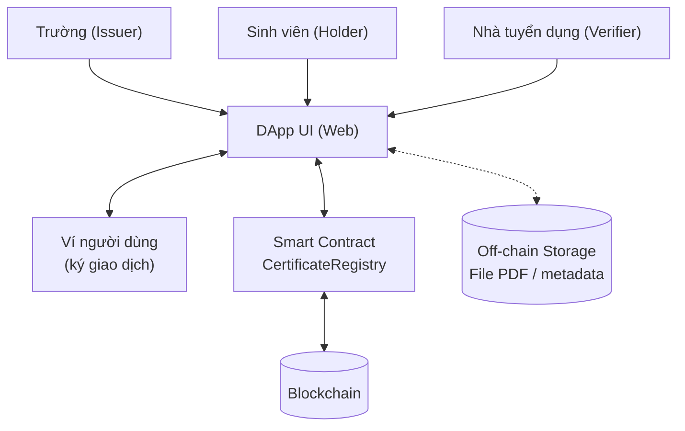

Kiến trúc theo đúng mô hình DApp: **Giao diện → Smart Contract → Blockchain**, có bổ sung **Off-chain Storage** cho dữ liệu lớn.

### 4.2. Phân chia dữ liệu On-chain và Off-chain

| Dữ liệu | Lưu ở đâu | Lý do |
|---|---|---|
| File chứng chỉ (PDF) | **Off-chain** | Dung lượng lớn, chi phí cao nếu lưu on-chain, có thể chứa thông tin cá nhân |
| Mã băm của file (`certHash`) | **On-chain** | Dùng để kiểm chứng tính toàn vẹn của file |
| Địa chỉ đơn vị cấp, địa chỉ người nhận | On-chain | Xác định quyền sở hữu và nguồn gốc |
| Thời điểm cấp, trạng thái (Hợp lệ/Thu hồi) | On-chain | Cần tin cậy, khó bị thay đổi |
| Liên kết dữ liệu mô tả (`metadataURI`) | On-chain (chỉ là đường dẫn) | Trỏ tới dữ liệu off-chain, không chứa thông tin nhạy cảm |

**Nguyên lý xác minh:** hàm băm cho cùng một file luôn ra cùng một giá trị, chỉ cần sửa một ký tự thì giá trị hoàn toàn khác. Nhà tuyển dụng nhận file PDF, tự tính hash rồi so với hash đã ghi trên Blockchain. Nếu khớp và trạng thái là "Hợp lệ", file đúng là bản gốc do trường cấp.

### 4.3. Thiết kế Smart Contract

#### 4.3.1. Cấu trúc dữ liệu

| Trường | Kiểu | Ý nghĩa |
|---|---|---|
| `issuer` | `address` | Ví của đơn vị cấp |
| `holder` | `address` | Ví của người được cấp |
| `issuedAt` | `uint64` | Thời điểm cấp (timestamp của block) |
| `status` | `enum Status { NotFound, Valid, Revoked }` | Trạng thái chứng chỉ |
| `metadataURI` | `string` | Liên kết dữ liệu off-chain |

Chứng chỉ được định danh bằng `certHash` (32 byte) và lưu trong `mapping(bytes32 => Certificate)`.

#### 4.3.2. Các hàm chính

| Hàm | Quyền gọi | Mô tả | Tốn gas |
|---|---|---|---|
| `setIssuer(address, bool)` | Owner | Thêm/gỡ quyền cấp chứng chỉ | Có |
| `issueCertificate(bytes32, address, string)` | Issuer | Cấp chứng chỉ mới, từ chối nếu đã tồn tại | Có |
| `revokeCertificate(bytes32)` | Issuer đã cấp chứng chỉ đó | Chuyển trạng thái sang Revoked | Có |
| `verifyCertificate(bytes32)` | Bất kỳ ai | Trả về trạng thái và thông tin chứng chỉ | Không (hàm `view` gọi ngoài chuỗi) |

#### 4.3.3. Sự kiện (Events)

- `IssuerUpdated(issuer, allowed)`
- `CertificateIssued(certHash, issuer, holder, issuedAt)`
- `CertificateRevoked(certHash, issuer, revokedAt)`

Sự kiện giúp giao diện theo dõi lịch sử và hỗ trợ **truy vết, kiểm toán**.

#### 4.3.4. Kiểm soát truy cập và xử lý lỗi

- `onlyOwner`: chỉ chủ hợp đồng mới thay đổi danh sách đơn vị cấp.
- `onlyIssuer`: chỉ đơn vị được ủy quyền mới cấp/thu hồi.
- Ràng buộc bổ sung: chỉ đơn vị **đã cấp** chứng chỉ mới được thu hồi chứng chỉ đó; không cấp trùng; không thu hồi hai lần; không cấp cho địa chỉ rỗng.
- Dùng *custom errors* (`NotOwner`, `NotIssuer`, `AlreadyIssued`, ...) để tiết kiệm gas và rõ nghĩa.

Mã nguồn đầy đủ: xem [`contracts/CertificateRegistry.sol`](../contracts/CertificateRegistry.sol) và [Phụ lục A](#phụ-lục-a-mã-nguồn-smart-contract).

### 4.4. Luồng nghiệp vụ

#### 4.4.1. Cấp chứng chỉ

```mermaid
sequenceDiagram
    actor T as Trường
    participant UI as DApp UI
    participant OFF as Off-chain Storage
    participant SC as Smart Contract
    participant BC as Blockchain

    T->>UI: Chọn file chứng chỉ + ví sinh viên
    UI->>UI: Tính certHash từ file
    UI->>OFF: Lưu file / metadata (tùy chọn)
    UI->>SC: issueCertificate(certHash, holder, metadataURI)
    SC->>SC: Kiểm tra quyền Issuer và chưa tồn tại
    SC->>BC: Ghi bản ghi + phát sự kiện CertificateIssued
    BC-->>UI: Giao dịch được xác nhận
    UI-->>T: Hiển thị thành công + mã QR cho sinh viên
```

#### 4.4.2. Xác minh chứng chỉ

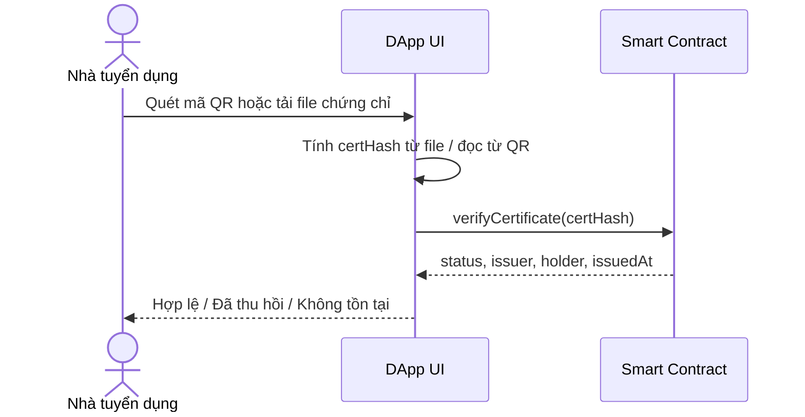

#### 4.4.3. Thu hồi chứng chỉ

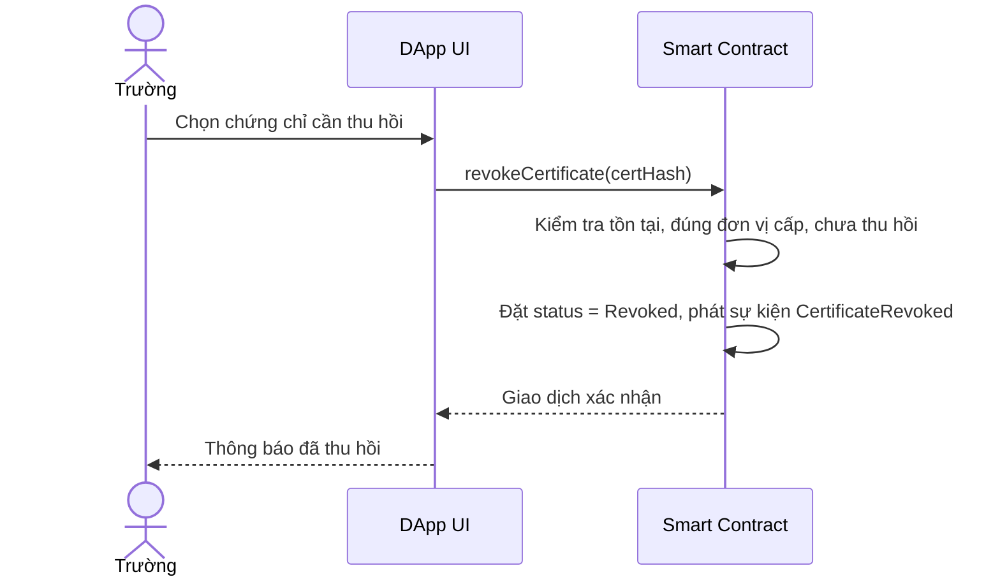

> Lưu ý: việc thu hồi **không xóa** bản ghi. Lịch sử "đã cấp" vẫn còn, chỉ đổi trạng thái. Điều này phù hợp với bản chất chỉ thêm mới của Blockchain.

### 4.5. Thiết kế giao diện

| Màn hình | Người dùng | Chức năng |
|---|---|---|
| Kết nối ví | Tất cả | Kết nối ví để ký giao dịch |
| Cấp chứng chỉ | Trường | Chọn file, nhập địa chỉ ví sinh viên, gửi giao dịch |
| Quản lý chứng chỉ | Trường | Danh sách đã cấp, nút thu hồi |
| Chứng chỉ của tôi | Sinh viên | Xem chứng chỉ, hiển thị mã QR |
| Xác minh | Nhà tuyển dụng | Quét QR / tải file, hiển thị kết quả |

### 4.6. Bảo mật và quyền riêng tư

| Vấn đề | Biện pháp |
|---|---|
| Giả mạo người cấp | Chỉ địa chỉ trong danh sách `isIssuer` mới cấp được; giao dịch có chữ ký số |
| Sửa nội dung file | Mọi thay đổi làm đổi hash nên xác minh thất bại |
| Lộ thông tin cá nhân | Không đưa thông tin cá nhân hay file gốc lên chuỗi, chỉ lưu hash |
| Mất khóa bí mật của trường | Dùng ví lạnh/ví đa chữ ký cho tài khoản quản trị (hướng phát triển) |
| Lỗi Smart Contract | Kiểm thử đầy đủ, đơn giản hóa logic, kiểm tra thủ công các trường hợp biên |

---

## Chương 5. Triển khai và kết quả

Toàn bộ mã nguồn, dữ liệu mẫu và kịch bản chạy nằm trong cùng repo. Các kết quả dưới đây là kết quả chạy thực tế trong quá trình xây dựng; bạn nên tự chạy lại (`npm test`, `npm run gas`) và chụp màn hình trên máy của mình.

### 5.1. Công nghệ sử dụng

| Thành phần | Công nghệ | Phiên bản |
|---|---|---|
| Smart Contract | Solidity (bật optimizer, runs = 200) | 0.8.26 |
| Môi trường phát triển, kiểm thử, triển khai | Hardhat + hardhat-toolbox (Mocha, Chai) | 2.29.1 / 6.1.2 |
| Kết nối Blockchain từ script và giao diện | ethers.js | 6.17.0 |
| Giao diện | HTML, CSS, JavaScript thuần (không framework) | - |
| Tạo mã QR | qrcode-generator (đóng gói sẵn trong `frontend/lib`) | 2.0.4 |
| Ví | MetaMask hoặc ví tương thích EIP-1193 | - |
| Mạng chạy thử | Hardhat Network cục bộ (chainId 31337) | - |
| Web server tĩnh | http-server | 14.x |
| Sinh PDF mẫu (tùy chọn) | Python 3 + reportlab | - |

### 5.2. Cấu trúc dự án

```
certificate-dapp/
├── contracts/
│   └── CertificateRegistry.sol       # Smart Contract
├── test/
│   └── CertificateRegistry.test.js   # 20 test (Mocha + Chai)
├── scripts/
│   ├── deploy.js                     # triển khai, ghi frontend/contract.json
│   ├── seed.js                       # nạp dữ liệu mẫu lên chuỗi
│   ├── gas-report.js                 # đo gas, ghi docs/gas-report.md
│   ├── hash-file.js                  # tính hash keccak256 của file
│   └── generate_sample_pdfs.py       # sinh PDF + metadata mẫu (tùy chọn)
├── data/
│   ├── certificates.json             # cấu hình dữ liệu mẫu (hư cấu)
│   ├── hashes.json                   # hash keccak256 của các PDF mẫu
│   ├── seeded.json                   # kết quả nạp dữ liệu lên chuỗi (ví dụ)
│   ├── sample-pdfs/                  # 6 PDF mẫu + 1 bản bị sửa
│   └── metadata/                     # metadata off-chain của từng chứng chỉ
├── frontend/
│   ├── index.html, style.css, app.js # giao diện DApp
│   ├── lib/                          # ethers (UMD), qrcode-generator
│   └── contract.json                 # (sinh ra bởi npm run deploy)
├── docs/
│   ├── BAO_CAO.md                    # báo cáo này
│   ├── gas-report.md                 # số liệu gas
│   └── images/                       # ảnh demo giao diện
├── hardhat.config.js
├── package.json
└── README.md
```

### 5.3. Hướng dẫn cài đặt và chạy

Yêu cầu: Node.js 18 trở lên.

```bash
npm install            # cài phụ thuộc
npm test               # chạy 20 test của Smart Contract
```

Chạy ứng dụng (cần 3 terminal):

```bash
# Terminal 1: mạng Blockchain cục bộ (in ra 20 tài khoản thử nghiệm)
npm run node

# Terminal 2: triển khai contract + nạp dữ liệu mẫu
npm run setup

# Terminal 3: chạy giao diện, rồi mở http://localhost:3000/frontend/
npm run serve
```

**Cấu hình MetaMask:** thêm mạng với RPC `http://127.0.0.1:8545`, chainId `31337`, ký hiệu ETH; sau đó nhập khóa riêng của các tài khoản thử nghiệm do `npm run node` in ra. Đây là các khóa công khai của Hardhat, **chỉ dùng cho mạng cục bộ, tuyệt đối không dùng trên mạng thật**. Phân vai theo dữ liệu mẫu:

| Tài khoản Hardhat | Vai trò trong dữ liệu mẫu |
|---|---|
| #0 | Owner (người triển khai), quản trị đơn vị cấp |
| #1 | Đơn vị cấp: Trường Đại học Công nghệ Mẫu |
| #2 | Đơn vị cấp: Trung tâm Ngoại ngữ Mẫu |
| #3 | Sinh viên Nguyễn Văn An (CERT-001, CERT-005) |
| #4, #5, #6, #7 | Sinh viên Trần Thị Bình, Lê Hoàng Cường, Phạm Minh Dũng, Võ Thanh Em |
| #8 trở đi | Tài khoản trống, dùng để thử cấp chứng chỉ mới |

Nhà tuyển dụng không cần ví: chỉ cần mở trang "Xác minh".

### 5.4. Dữ liệu mẫu

Toàn bộ dữ liệu là **hư cấu** (tên người, mã số, đơn vị cấp đều không có thật); trên mỗi PDF có dòng cảnh báo "MẪU DEMO". Hash là `keccak256` của nội dung từng file PDF (tính bằng `npm run hash -- --all`).

| Mã | Loại | Người nhận | Đơn vị cấp | Trạng thái | Mã băm (keccak256) |
|---|---|---|---|---|---|
| CERT-001 | Bằng tốt nghiệp: Kỹ sư Công nghệ thông tin | Nguyễn Văn An | Trường Đại học Công nghệ Mẫu | Hợp lệ | `0xbf84171e1c25ec19a21e5bfaefa567ef38e580e5c8af74751220f40cf6251cb9` |
| CERT-002 | Bằng tốt nghiệp: Kỹ sư Khoa học dữ liệu | Trần Thị Bình | Trường Đại học Công nghệ Mẫu | Hợp lệ | `0x5d83af049360c46be4abf63fd5fb765b2c9ebb1087dd59d71ab31824df071328` |
| CERT-003 | Chứng chỉ: Lập trình Blockchain cơ bản | Lê Hoàng Cường | Trường Đại học Công nghệ Mẫu | Hợp lệ | `0xb9b7a83b04cfa44068be9742486644dacb6e96dff022883cce0848fac4ddaafe` |
| CERT-004 | Giấy chứng nhận: Hoàn thành khóa Trí tuệ nhân tạo cơ bản | Phạm Minh Dũng | Trường Đại học Công nghệ Mẫu | Hợp lệ | `0x68be0737f235659342adcc2ac430923a62e0cb033dce5a61d289385bc7d384a1` |
| CERT-005 | Chứng chỉ: Tiếng Anh trình độ B1 | Nguyễn Văn An | Trung tâm Ngoại ngữ Mẫu | Hợp lệ | `0x601fd028f02f1f73f225f60d1a8746f2065a4edf72ad88ec2a9243159e0fc71d` |
| CERT-006 | Chứng chỉ: Tiếng Anh trình độ B1 | Võ Thanh Em | Trung tâm Ngoại ngữ Mẫu | Đã thu hồi | `0xd1957c05421991324b1305e0620613056db7864b7a3e9abee1226a870d766d0a` |
| CERT-001_tampered | Bản sửa của CERT-001 ("Giỏi" → "Xuất sắc") | (dùng để demo) | Không được cấp | Không tìm thấy | `0x2a78f5aac93b4065913baf603e6931f489749bf84c8dc2bb2f442671c6a3efa2` |

Trạng thái "Đã thu hồi" của CERT-006 được tạo có chủ đích để demo chức năng thu hồi. Bản `CERT-001_tampered.pdf` chỉ khác bản gốc ở một chi tiết nhỏ nhưng có hash hoàn toàn khác, dùng để chứng minh phát hiện chỉnh sửa.

Dữ liệu mô tả (tên, mã số, kết quả, ...) nằm ở `data/metadata/*.json` (off-chain). Trên chuỗi chỉ có hash, địa chỉ ví, thời điểm, trạng thái và đường dẫn metadata.

### 5.5. Kiểm thử Smart Contract

Chạy bằng `npm test` (Hardhat, Mocha, Chai). **Kết quả: 20/20 test đạt.** Mười kịch bản chính (KB1 đến KB10) ứng với các test có gắn nhãn tương ứng:

| STT | Kịch bản | Kết quả mong đợi | Kết quả thực tế |
|---|---|---|---|
| KB1 | Owner thêm một Issuer | `isIssuer` = true, có sự kiện `IssuerUpdated` | Đạt |
| KB2 | Người không có quyền cấp chứng chỉ | Bị từ chối (`NotIssuer`) | Đạt |
| KB3 | Issuer cấp chứng chỉ mới | Trạng thái `Valid`, có sự kiện `CertificateIssued`, đúng timestamp | Đạt |
| KB4 | Cấp lại chứng chỉ có cùng hash (kể cả bởi issuer khác) | Bị từ chối (`AlreadyIssued`) | Đạt |
| KB5 | Xác minh chứng chỉ hợp lệ (người gọi không có quyền gì) | Trả về `Valid` cùng thông tin | Đạt |
| KB6 | Xác minh hash chưa từng được cấp | Trả về `NotFound` | Đạt |
| KB7 | Issuer thu hồi chứng chỉ do mình cấp | `Revoked`, có sự kiện, bản ghi cấp vẫn còn | Đạt |
| KB8 | Issuer khác thu hồi chứng chỉ không phải của mình | Bị từ chối (`NotCertificateIssuer`) | Đạt |
| KB9 | Thu hồi chứng chỉ đã thu hồi | Bị từ chối (`AlreadyRevoked`) | Đạt |
| KB10 | Sửa một ký tự trong nội dung rồi xác minh | `NotFound` do hash đổi | Đạt |

Các test bổ sung: owner mặc định là issuer; chỉ owner được `setIssuer`; gỡ quyền issuer thì không cấp được nữa; từ chối cấp cho `address(0)`; thu hồi chứng chỉ không tồn tại; người không có quyền không thu hồi được; chứng chỉ đã thu hồi không thể cấp lại bằng cùng hash; lọc sự kiện theo holder và theo issuer.

### 5.6. Kiểm thử giao diện (end-to-end)

Giao diện được kiểm thử tự động bằng trình duyệt headless (Chromium, Playwright) chạy trên mạng Hardhat cục bộ với dữ liệu mẫu. **Kết quả: 35/35 bước đạt**, gồm:

| Nhóm | Nội dung đã kiểm tra |
|---|---|
| Khách (không ví) | Tải PDF gốc: Hợp lệ; tải PDF bị sửa: Không tìm thấy; chứng chỉ đã thu hồi: Đã thu hồi; mã băm sai định dạng bị báo lỗi; mở liên kết `?verify=<hash>` tự xác minh; lịch sử sự kiện và metadata hiển thị |
| Phân quyền giao diện | Khách và sinh viên không thấy tab cấp/quản lý/quản trị; tab hiện đúng theo vai trò Owner/Issuer |
| Sinh viên | Xem đúng 2 chứng chỉ của mình; hiển thị mã QR (đã giải mã thử QR ra đúng liên kết xác minh) |
| Đơn vị cấp | Chọn file tự điền hash; chặn địa chỉ sai; cấp mới thành công; cấp trùng bị từ chối; thu hồi thành công và trạng thái cập nhật |
| Owner | Thêm đơn vị cấp mới và danh sách cập nhật |
| Xử lý lỗi | Lỗi `NotIssuer` từ contract được dịch sang tiếng Việt |
| Di động | Màn hình 390 px không tràn ngang |

> **Lưu ý trung thực:** vì môi trường kiểm thử tự động không có tiện ích MetaMask, bước ký giao dịch được thay bằng một "ví giả lập" dùng chung các tài khoản đã mở khóa của node Hardhat. Logic của DApp, Smart Contract và chuỗi Hardhat là thật; chỉ hộp thoại xác nhận của MetaMask là không xuất hiện. Hãy tự thử lại với MetaMask thật trước khi nộp bài.

### 5.7. Chi phí gas

Đo bằng `npm run gas` trên mạng Hardhat (solc 0.8.26, optimizer runs = 200). Phí thực tế bằng gas nhân giá gas của mạng tại thời điểm giao dịch.

| Thao tác | Gas | Ghi chú |
|---|---:|---|
| Triển khai contract | 619.831 | Một lần |
| `setIssuer` (thêm issuer mới) | 47.723 | |
| `issueCertificate` (metadataURI rỗng) | 74.947 | |
| `issueCertificate` (URI 27 ký tự) | 95.331 | Chuỗi metadata dài hơn thì gas tăng |
| `revokeCertificate` | 33.513 | Chỉ cập nhật trạng thái |
| `verifyCertificate` | 0 khi gọi ngoài chuỗi | Hàm `view`; nếu gọi như giao dịch thì ước lượng 29.207 |

Nhận xét: việc **xác minh miễn phí** là điểm quan trọng với nhà tuyển dụng, còn chi phí nằm ở phía đơn vị cấp. Đưa `metadataURI` dài lên chuỗi làm tốn thêm khoảng 20 nghìn gas cho mỗi chứng chỉ, vì vậy nên để trống hoặc dùng đường dẫn ngắn.

### 5.8. Ảnh demo

Ảnh chụp từ lần chạy kiểm thử giao diện ở mục 5.6 (dùng ví giả lập). Bạn nên chụp lại bằng MetaMask thật để đưa vào bản nộp.

**Xác minh chứng chỉ hợp lệ** (tải `CERT-001.pdf`):

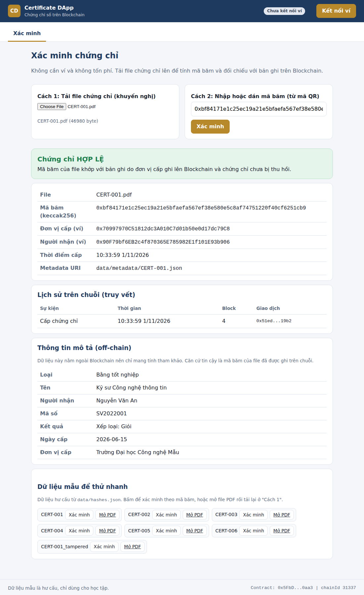

**Phát hiện file bị sửa** (tải `CERT-001_tampered.pdf`):

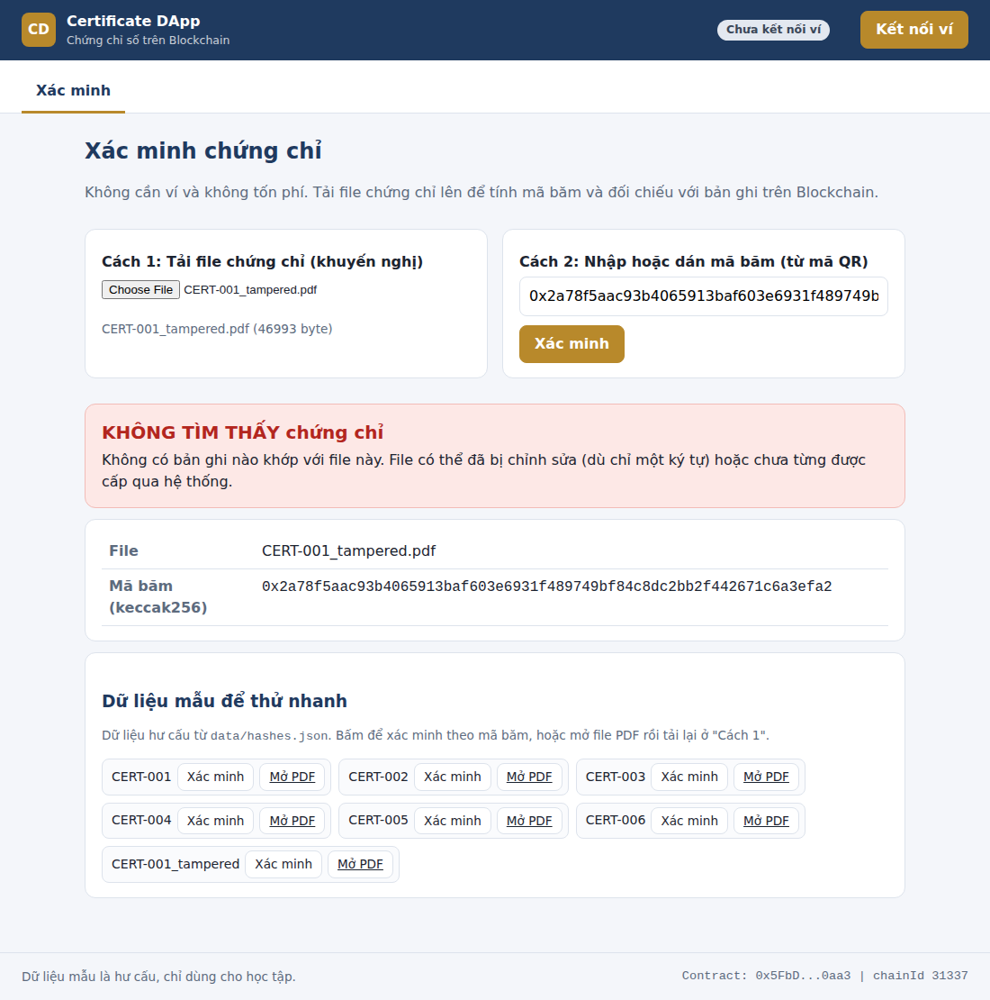

**Chứng chỉ đã bị thu hồi** (CERT-006):

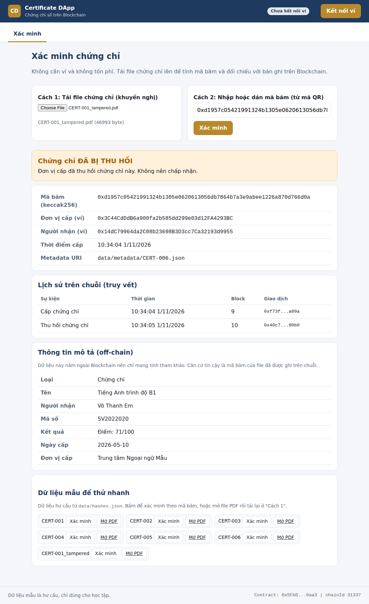

**Chứng chỉ của sinh viên và mã QR:**

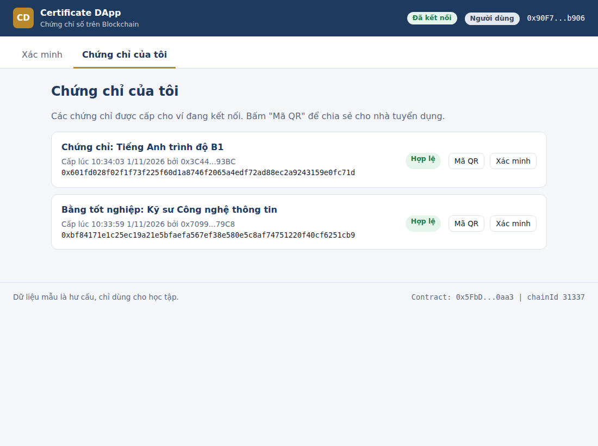

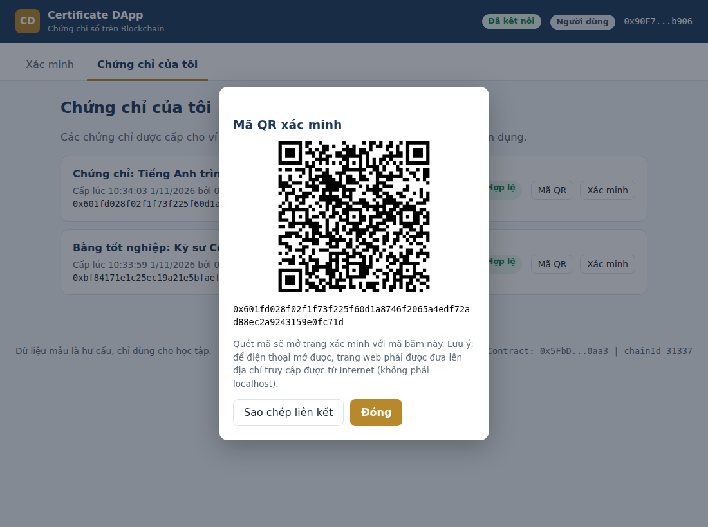

**Đơn vị cấp: cấp chứng chỉ mới và quản lý/thu hồi:**

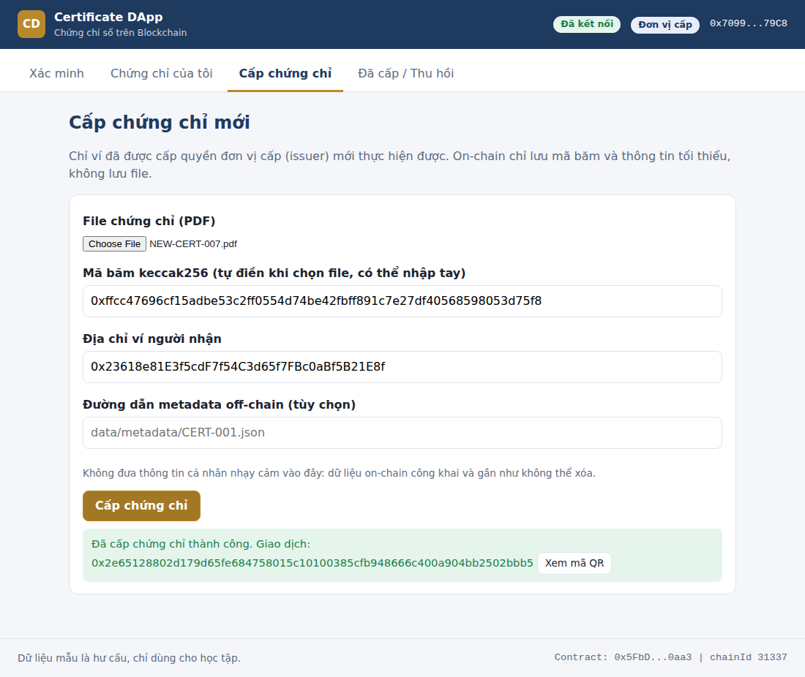

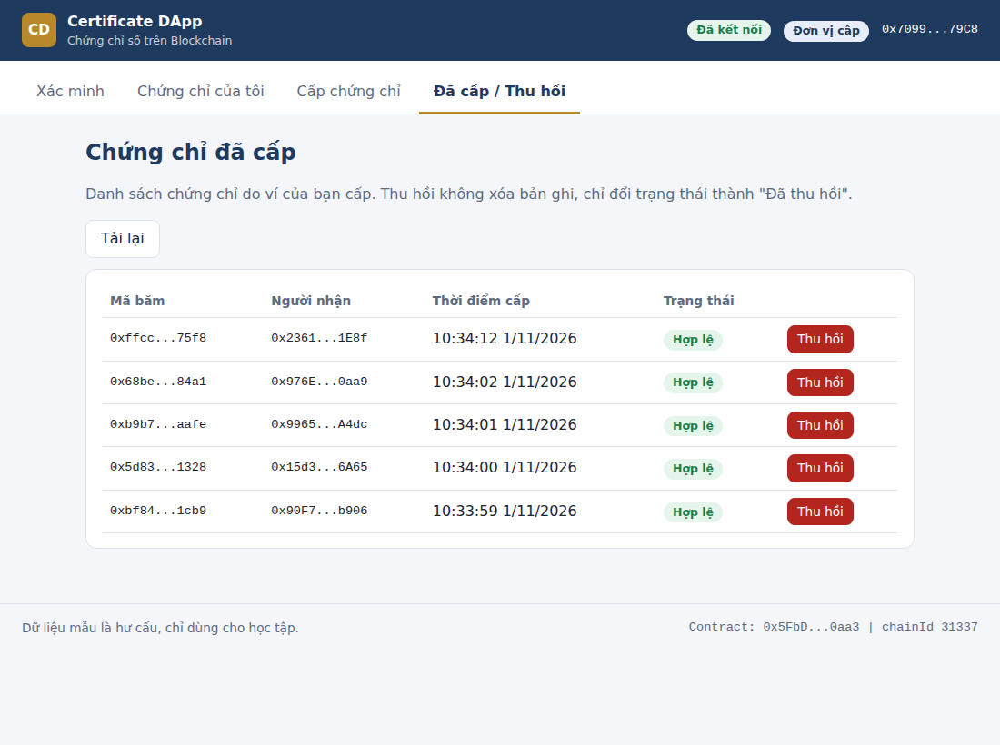

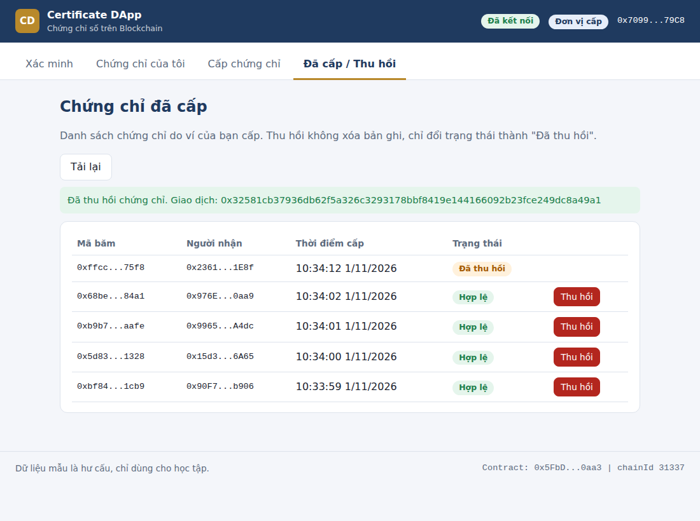

**Owner quản trị đơn vị cấp:**

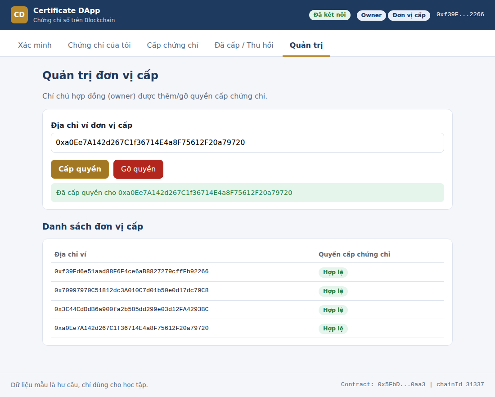

**Thông báo lỗi khi ví không còn quyền cấp:**

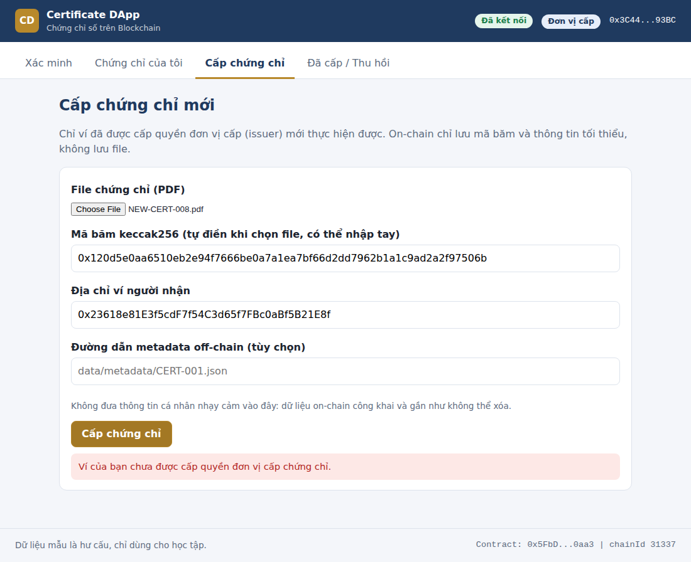

**Giao diện điện thoại:**

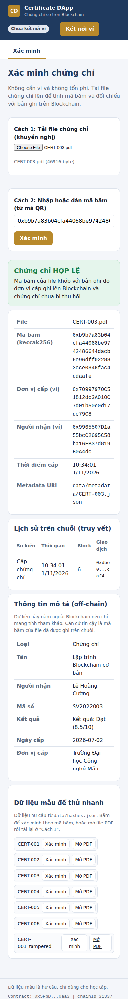

### 5.9. Hạn chế của bản cài đặt

- **Chưa kiểm thử với MetaMask thật và chưa triển khai lên testnet công khai.** Cấu hình Sepolia trong `hardhat.config.js` là tùy chọn và chưa được chạy thử.
- **Chưa kiểm toán bảo mật** Smart Contract; chỉ có bộ test chức năng.
- **Truy vấn sự kiện từ block triển khai** phù hợp quy mô demo; hệ thống lớn cần dịch vụ lập chỉ mục (indexer) hoặc The Graph.
- **Metadata off-chain không được bảo vệ toàn vẹn** bởi Blockchain (chỉ file PDF có hash trên chuỗi), nên giao diện ghi chú rõ đây là thông tin tham khảo. Có thể cải thiện bằng cách băm cả metadata.
- **Mã QR chỉ quét được khi trang web được đưa lên địa chỉ truy cập từ Internet**, không phải `localhost`.
- **Một ví đơn lẻ giữ quyền cấp** là điểm yếu quản trị khóa; nên dùng ví đa chữ ký trong thực tế.

---

## Chương 6. Đánh giá và hướng phát triển

### 6.1. So sánh với giải pháp truyền thống

| Tiêu chí | Hệ thống truyền thống (server + CSDL) | DApp chứng chỉ số |
|---|---|---|
| Nơi lưu và xác thực | Máy chủ của từng trường | Blockchain, ai cũng kiểm chứng được |
| Rủi ro sửa dữ liệu | Quản trị viên có thể sửa/xóa | Bản ghi on-chain khó thay đổi |
| Điểm lỗi duy nhất | Có (server của trường) | Không với dữ liệu on-chain |
| Xác minh bởi bên thứ ba | Phải liên hệ trường hoặc dùng API riêng | Tự xác minh trực tiếp |
| Chi phí vận hành | Server, bảo trì | Phí giao dịch khi ghi dữ liệu |
| Độ phức tạp triển khai | Thấp, quen thuộc | Cao hơn, cần ví, khóa, quản lý gas |

### 6.2. Ưu điểm

- Giảm nguy cơ làm giả vì mọi thay đổi nội dung file đều bị phát hiện qua hash.
- Nhà tuyển dụng tự xác minh nhanh, không cần phụ thuộc quy trình thủ công của trường.
- Lịch sử cấp/thu hồi được ghi nhận, có thể truy vết và kiểm toán.
- Smart Contract thực thi quy tắc phân quyền một cách nhất quán.

### 6.3. Hạn chế và thách thức

Đối chiếu với 7 nhóm thách thức của Blockchain:

| Thách thức | Biểu hiện trong đề tài | Hướng xử lý |
|---|---|---|
| Khả năng mở rộng | Lượng chứng chỉ lớn làm tăng số giao dịch ghi | Dùng Layer 2, gom nhiều chứng chỉ vào một giao dịch (ví dụ Merkle Root) |
| Năng lượng | Phụ thuộc cơ chế đồng thuận | Chọn mạng PoS hoặc mạng PoA/liên doanh |
| Khó sử dụng | Người dùng phải có ví, giữ khóa bí mật | Thiết kế UX đơn giản; cho phép xác minh không cần ví |
| Pháp lý | Giá trị pháp lý của chứng chỉ số, dữ liệu cá nhân trên chuỗi công khai | Chỉ lưu hash; trao đổi với cơ quan quản lý khi triển khai thật |
| Bảo mật | Lỗi Smart Contract, lộ khóa bí mật của trường | Kiểm thử kỹ, dùng ví lạnh/ví đa chữ ký |
| Tương tác, chuẩn hóa | Mỗi trường có thể dùng chuỗi khác nhau | Thống nhất chuẩn dữ liệu chứng chỉ giữa các đơn vị |
| Hoạt động phi pháp | Ít liên quan | Không có tài sản có giá trị tiền tệ, rủi ro thấp |

**Lưu ý quan trọng:** Blockchain chỉ đảm bảo *"bản ghi này được một địa chỉ ví ủy quyền ghi vào và không bị sửa"*. Hệ thống **không tự chứng minh** rằng khóa của trường chưa bị lộ hay nhân viên cấp đúng người. Độ tin cậy cuối cùng vẫn phụ thuộc vào quy trình quản lý khóa và danh sách đơn vị được ủy quyền.

### 6.4. Hướng phát triển

1. **Mạng liên doanh (Consortium):** nhiều trường và tổ chức cùng vận hành các nút xác thực.
2. **Danh tính số và đa chữ ký:** quản lý quyền cấp chứng chỉ bằng ví đa chữ ký thay vì một ví đơn.
3. **Lưu trữ phi tập trung cho file:** dùng hệ thống lưu trữ off-chain có địa chỉ theo nội dung (content-addressed).
4. **Kết hợp AI:** môn học có đề cập hướng Blockchain + AI, trong đó AI phân tích và Smart Contract thực thi hành động theo quy tắc. Với đề tài này, AI có thể hỗ trợ trích xuất thông tin từ ảnh/PDF chứng chỉ (OCR) để điền sẵn dữ liệu, hoặc phát hiện hồ sơ bất thường để cảnh báo trước khi ghi lên chuỗi.
5. **Mở rộng sang các bài toán tương tự:** hồ sơ học tập, giấy phép, chứng nhận nghề nghiệp.

---

## Chương 7. Kết luận

Báo cáo đã trình bày cơ sở lý thuyết về Blockchain, Smart Contract và DApp, phân tích bài toán xác minh chứng chỉ số và thiết kế một hệ thống gồm giao diện, Smart Contract và Blockchain, có kết hợp lưu trữ off-chain. Thiết kế chỉ lưu mã băm và thông tin tối thiểu on-chain nhằm cân bằng giữa tính bất biến, quyền riêng tư và chi phí.

Kết quả cho thấy Blockchain phù hợp với bài toán nhiều bên cần niềm tin như xác minh chứng chỉ, nhưng không phải giải pháp cho mọi vấn đề: độ tin cậy vẫn phụ thuộc vào quản lý khóa, quy trình cấp phát và khung pháp lý. Đề tài là bước đầu để hình thành tư duy thiết kế DApp trước khi đi sâu vào lập trình Smart Contract.

Về mặt thực nghiệm, bản mẫu gồm Smart Contract với 20 test đạt, giao diện kiểm thử đầy đủ các luồng cấp, xác minh, thu hồi và quản trị, cùng bộ dữ liệu mẫu để tái hiện kết quả. Việc xác minh không tốn phí và phát hiện được chỉnh sửa dù rất nhỏ trong file; phần chi phí nằm ở phía đơn vị cấp. Hạn chế chính là chưa thử với ví thật, chưa lên testnet và chưa kiểm toán bảo mật (xem mục 5.9).

> **TODO (của bạn):** thêm 2 đến 3 câu về bài học cá nhân rút ra sau khi làm đề tài.

---

## Tài liệu tham khảo

1. Nội dung bài giảng môn Blockchain, Chương 1 (các phần 1.1 – 1.9): giới thiệu, lịch sử phát triển, thành phần cơ bản và mở rộng, phân loại, đặc điểm, lợi ích và thách thức, ứng dụng.
2. S. Nakamoto, *Bitcoin: A Peer-to-Peer Electronic Cash System*, 2008. https://bitcoin.org/bitcoin.pdf
3. Solidity Documentation. https://docs.soliditylang.org
4. Ethereum.org, *Ethereum developer documentation*. https://ethereum.org/en/developers/docs/
5. Hardhat Documentation. https://hardhat.org/docs
6. ethers.js Documentation. https://docs.ethers.org

---

## Phụ lục

### Phụ lục A. Mã nguồn Smart Contract

```solidity
// SPDX-License-Identifier: MIT
pragma solidity ^0.8.20;

/// @title CertificateRegistry
/// @notice Lưu mã băm (hash) của chứng chỉ để cấp, thu hồi và xác minh.
/// @dev File chứng chỉ (PDF) lưu off-chain; on-chain chỉ lưu hash và thông tin tối thiểu.
contract CertificateRegistry {
    // ---------- Kiểu dữ liệu ----------
    enum Status { NotFound, Valid, Revoked }

    struct Certificate {
        address issuer;      // đơn vị cấp (ví của trường)
        address holder;      // ví của người được cấp
        uint64 issuedAt;     // thời điểm cấp (timestamp của block)
        Status status;       // trạng thái chứng chỉ
        string metadataURI;  // liên kết dữ liệu off-chain (không chứa thông tin cá nhân nhạy cảm)
    }

    // ---------- Trạng thái ----------
    address public owner;
    mapping(address => bool) public isIssuer;
    mapping(bytes32 => Certificate) private certificates; // certHash => Certificate

    // ---------- Sự kiện ----------
    event IssuerUpdated(address indexed issuer, bool allowed);
    event CertificateIssued(
        bytes32 indexed certHash,
        address indexed issuer,
        address indexed holder,
        uint64 issuedAt
    );
    event CertificateRevoked(bytes32 indexed certHash, address indexed issuer, uint64 revokedAt);

    // ---------- Lỗi tùy chỉnh ----------
    error NotOwner();
    error NotIssuer();
    error AlreadyIssued();
    error CertificateNotFound();
    error NotCertificateIssuer();
    error AlreadyRevoked();
    error InvalidHolder();

    // ---------- Phân quyền ----------
    modifier onlyOwner() {
        if (msg.sender != owner) revert NotOwner();
        _;
    }

    modifier onlyIssuer() {
        if (!isIssuer[msg.sender]) revert NotIssuer();
        _;
    }

    constructor() {
        owner = msg.sender;
        isIssuer[msg.sender] = true;
        emit IssuerUpdated(msg.sender, true);
    }

    /// @notice Thêm hoặc gỡ quyền cấp chứng chỉ của một đơn vị.
    function setIssuer(address issuer, bool allowed) external onlyOwner {
        isIssuer[issuer] = allowed;
        emit IssuerUpdated(issuer, allowed);
    }

    /// @notice Cấp chứng chỉ mới.
    /// @param certHash Mã băm (32 byte) của file chứng chỉ, tính ở phía client.
    /// @param holder Địa chỉ ví của người được cấp.
    /// @param metadataURI Liên kết dữ liệu off-chain (có thể để rỗng).
    function issueCertificate(
        bytes32 certHash,
        address holder,
        string calldata metadataURI
    ) external onlyIssuer {
        if (holder == address(0)) revert InvalidHolder();
        if (certificates[certHash].status != Status.NotFound) revert AlreadyIssued();

        uint64 nowTs = uint64(block.timestamp);
        certificates[certHash] = Certificate({
            issuer: msg.sender,
            holder: holder,
            issuedAt: nowTs,
            status: Status.Valid,
            metadataURI: metadataURI
        });

        emit CertificateIssued(certHash, msg.sender, holder, nowTs);
    }

    /// @notice Thu hồi chứng chỉ (chỉ đơn vị đã cấp mới được thu hồi).
    function revokeCertificate(bytes32 certHash) external onlyIssuer {
        Certificate storage c = certificates[certHash];
        if (c.status == Status.NotFound) revert CertificateNotFound();
        if (c.issuer != msg.sender) revert NotCertificateIssuer();
        if (c.status == Status.Revoked) revert AlreadyRevoked();

        c.status = Status.Revoked;
        emit CertificateRevoked(certHash, msg.sender, uint64(block.timestamp));
    }

    /// @notice Xác minh chứng chỉ. Hàm view nên không tốn phí gas khi gọi từ bên ngoài.
    function verifyCertificate(bytes32 certHash)
        external
        view
        returns (
            Status status,
            address issuer,
            address holder,
            uint64 issuedAt,
            string memory metadataURI
        )
    {
        Certificate storage c = certificates[certHash];
        return (c.status, c.issuer, c.holder, c.issuedAt, c.metadataURI);
    }
}
```

### Phụ lục B. Thuật ngữ

| Thuật ngữ | Giải thích |
|---|---|
| Blockchain | Cơ sở dữ liệu phân tán lưu dưới dạng các khối liên kết bằng mã băm |
| Hash | "Vân tay" số của dữ liệu; đổi dữ liệu thì hash đổi |
| Smart Contract | Chương trình chạy trên Blockchain, tự thực thi khi đủ điều kiện |
| DApp | Ứng dụng phi tập trung = giao diện + Smart Contract + Blockchain |
| On-chain / Off-chain | Dữ liệu lưu trên Blockchain / lưu ngoài Blockchain |
| Gas | Phí tính toán khi ghi/thực thi giao dịch trên Ethereum |
| Wallet | Ví quản lý khóa công khai và khóa bí mật |
| Issuer / Holder / Verifier | Bên cấp / bên được cấp / bên xác minh chứng chỉ |
